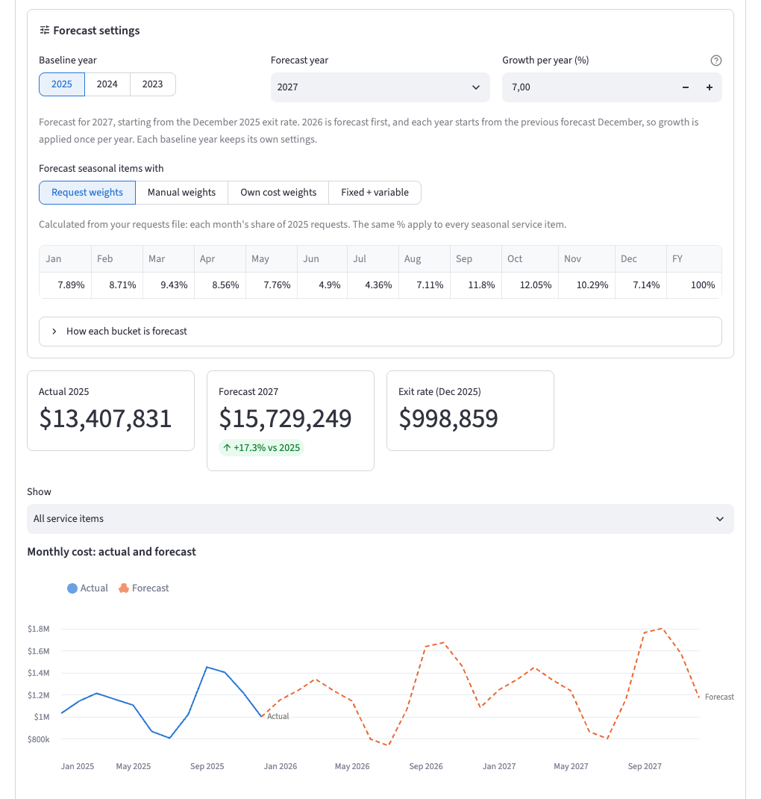
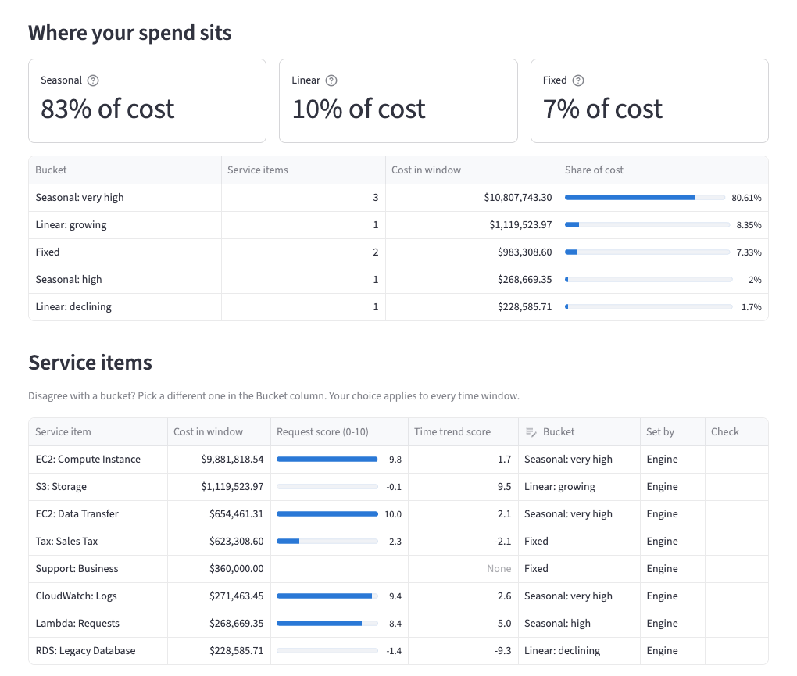

# Cloud Forecasting Engine

An open forecasting engine for FinOps teams. Upload your monthly cloud cost and request volumes, find out what drives each cost, and get a forecast for the next 12 months.



## How it works

1. **Add your data**: monthly cost per service item and total requests (API calls) per month, for at least 12 months.
2. **Find the cost drivers**: each service item is compared with requests, one calendar year at a time, and placed in a bucket.
3. **Forecast any future year**: pick a baseline year, a forecast year (for example 2027 from 2025 data) and a growth rate per year. The engine forecasts every service item with the method that suits its bucket.

| Bucket | What it means | Example | How it is forecast |
|---|---|---|---|
| **Seasonal** (very high, high, mid) | Cost follows requests: correlation of 0.5 or more | Compute, data transfer | Request weights, manual weights, the item's own cost weights, or fixed + variable (LINEST) |
| **Linear** (growing, declining) | Cost does not follow requests | Storage, a workload being retired | A constant monthly step from the December exit rate |
| **Fixed** | Cost barely moves (under 5% swing) | Support, tax | The same step, without day scaling |

To forecast more than one year ahead, the engine repeats the method one year at a time: each year starts from the previous year's forecast December, so growth is applied once per year.



Marketplace and other third-party charges are flagged and left out by default: they are spend with other vendors, billed through your cloud provider, and do not follow cloud usage.

## Prepare your files

Download the templates and replace the example rows with your own data:

- [**templates/cost_template.csv**](templates/cost_template.csv): one row per service item per month

  ```csv
  month,service_item,cost
  2025-01-01,EC2: Compute Instance,812345.67
  2025-01-01,S3: Storage,41200.00
  ```

- [**templates/requests_template.csv**](templates/requests_template.csv): one row per month

  ```csv
  month,requests
  2025-01-01,123456789012
  ```

Tips:

- Use **at least 12 months**, ideally full calendar years (January to December). More history is better.
- Name service items `Service: Item`, for example `EC2: Compute Instance`. The part before the colon becomes the service.
- Use the first day of the month for `month` (`2025-01-01`). Daily rows are added up into months automatically.
- Values such as `$1,234.50` or `123,456,789,012` are fine, and so are column names such as `date`, `amount` or `usage type`.
- Spreadsheets with one column per month, tab-separated files and Excel files also work.

The [examples/](examples/) folder has three years of made-up sample data. In the app, pick **Try sample data** to explore without your own files.

## Run it

You need [uv](https://docs.astral.sh/uv/getting-started/installation/), a Python project manager.

```bash
git clone https://github.com/parsakolivand/Cloud-Forecasting-Engine.git
cd Cloud-Forecasting-Engine
uv sync
uv run streamlit run streamlit_app.py --server.address localhost
```

Then open http://localhost:8501.

To pull costs straight from AWS Cost Explorer instead of uploading a file, install the AWS extra with `uv sync --extra aws`. The engine uses your local AWS login (profile or SSO) and never asks for access keys.

### Host your own copy

The app can be hosted for free on [Streamlit Community Cloud](https://share.streamlit.io): sign in with GitHub, choose **Create app**, select this repository, branch `main` and main file `streamlit_app.py`, then deploy.

## Privacy

Your files are processed in memory for your session only and are never stored or sent anywhere else. Running locally keeps your billing data on your own machine. On a hosted copy, files are processed on that host's servers, so for sensitive data, run it locally.

## Development

```bash
uv run pytest                                      # tests
uv run ruff check src tests examples streamlit_app.py
```

The engine is plain Python in [src/cfe/](src/cfe/): `ingest` reads files, `quality` checks and cleans data, `drivers` assigns buckets, `forecast` builds forecasts, and `app` is the web interface.

## Roadmap

- Forecast accuracy reports across past years (backtesting)
- Connectors for Azure and Google Cloud billing
- Support for the FinOps Open Cost and Usage Specification (FOCUS)
